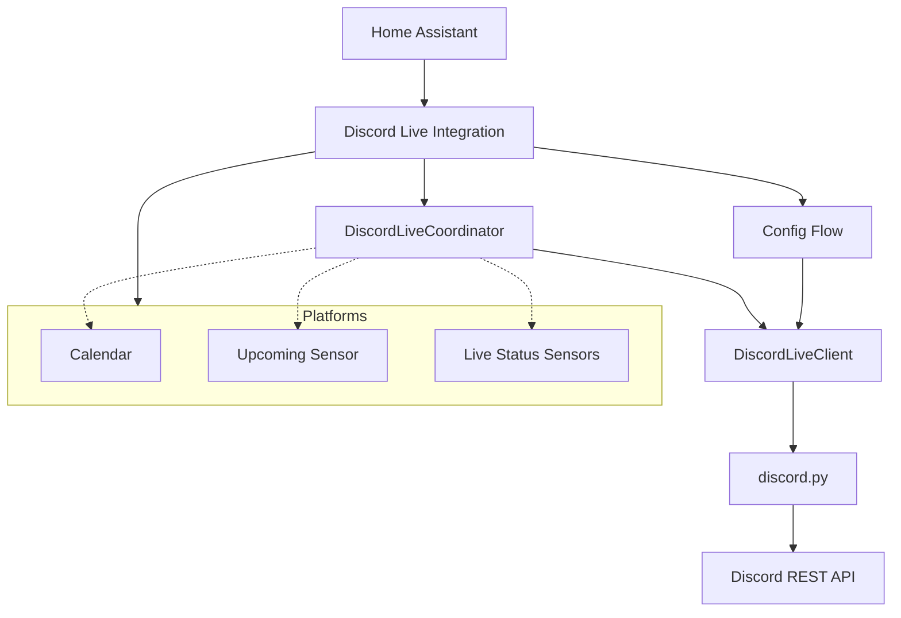

# Architecture of Discord Live Integration

This document describes the architectural design and data flow of the Discord Live integration for Home Assistant.

## Overview

The Discord Live integration tracks **guild scheduled events** on Discord servers. It groups servers into "Server Groups", each appearing as a single device in Home Assistant with associated sensors and a calendar. An event is *live* while Discord reports its status as `ACTIVE`.

The integration uses [discord.py](https://github.com/Rapptz/discord.py) in **REST-only mode**: the client logs in with a bot token but never opens a gateway (websocket) connection, so no intents are needed.

## Component Diagram

## Core Components

### 1. API wrapper (`api.py`)
`DiscordLiveClient` is the only module that imports discord.py.
- Converts discord.py objects to plain `GuildInfo` and `DiscordEvent` dataclasses.
- Maps discord.py errors to `DiscordAuthError` (rejected token), `DiscordGuildUnavailable` (bot kicked, or guild gone) and `DiscordConnectionError` (everything else).
- Events are fetched as raw API payloads and then turned into discord.py `ScheduledEvent` objects, because discord.py drops the `recurrence_rule` field. The rule is parsed into a `RecurrenceRule` (`recurrence.py`).
- The rest of the integration and the tests never touch discord.py, so the client can be replaced by a plain aiohttp client or a separate package without changing anything else.

### 2. Recurrence (`recurrence.py`)
Discord returns only the next occurrence of a recurring event. `RecurrenceRule.occurrences()` expands the rule into later start times. It covers the patterns Discord supports: daily (optionally on a set of weekdays), weekly or every other week, monthly on the nth weekday, and yearly on a date. Occurrences keep the UTC time of day of the rule start, and the expansion is bounded so a malformed rule can't loop forever. No third-party library is needed, because `python-dateutil` isn't a Home Assistant core dependency.

### 3. Configuration Flow (`config_flow.py`)
- **User step**: group name and bot token. The token is validated by logging in and listing the bot's guilds.
- **Guilds step**: multi-select of the guilds the bot is a member of.
- **Reauth**: started automatically when Discord rejects the token. It asks for a new token.
- **Options flow**: edit the guild selection. Guilds the bot has lost access to stay in the list so they can be deselected.

The token and the selected guild IDs (as strings) are stored in the config entry's `data`. The unique ID is the slugified group name.

### 4. Coordinator (`coordinator.py`)

#### DiscordLiveCoordinator
- **Update strategy**: every minute (`DEFAULT_UPDATE_INTERVAL`) it fetches the scheduled events of every guild in the group. One call per guild returns both upcoming events and their live status, so the two-tier polling used by the YouTube integration is not needed. Guild names and icons are refreshed every 30 minutes (`GUILD_INFO_INTERVAL`).
- **Data**: a `DiscordLiveCoordinatorData` object containing:
    - `events`: the scheduled and active events currently returned by Discord.
    - `ended`: recently ended occurrences (`EndedEvent`: a snapshot of the event plus `ended_at`).
- **Ended events**: Discord stops returning an event once it completes, and a recurring event moves on to its next occurrence under the same ID. The coordinator remembers the last live snapshot of each event. When an event is no longer returned as active, the snapshot is recorded as ended at the current time with its status set to completed, and kept for 24 hours (`ENDED_EVENT_RETENTION`). Occurrences are identified by `(event ID, start time)`.
- **Working state vs. snapshot**: the coordinator keeps mutable working state across update cycles (`_events_by_guild`, `_live`, `_ended`) and snapshots it into a fresh `DiscordLiveCoordinatorData` on every update. `self.data` is never mutated in place.
- **Single source of truth**: the shared helpers `relevant_events()`, `calendar_events()`, `future_occurrences()`, `events_for_guild()`, `live_events()`, `event_end_time()` and `is_event_active()` are used by every platform, so the calendar and sensors stay consistent with each other.
- **Error handling**:
    - A rejected token raises `ConfigEntryAuthFailed`, which starts the reauth flow.
    - A guild the bot can no longer access is added to `unavailable_guilds`, and its binary sensor becomes unavailable. The other guilds keep updating.
    - A connection error keeps that guild's previous events. The update only fails when every guild failed and there is no previous data.

### 5. Platforms

#### Calendar (`calendar.py`)
- Uses `calendar_events()` to show scheduled, live and recently ended events, plus the future occurrences of recurring events within the requested range.
- The event end is the observed end once an event has ended, then the end time set in Discord, then the default of 2 hours (`DEFAULT_EVENT_DURATION_HOURS`). A live event is kept open at least 30 minutes past now.

#### Sensor (`sensor.py`)
`DiscordLiveUpcomingSensor` is designed for consumption by external devices like ESPHome.
- **State**: count of upcoming or live events (via `is_event_active()`), including repeats of recurring events up to 30 days ahead (`UPCOMING_RECURRENCE_HORIZON`).
- **Attributes**: a flat list of the next 5 events.

#### Binary Sensor (`binary_sensor.py`)
- **Guild sensor**: one per guild in the group. `on` while that guild has a live event.
- **Group sensor**: one per group. `on` if *any* guild in the group has a live event.
- While live, attributes expose the event's name, link and type, and the event cover is shown as the entity picture.

## Design Decisions

- **Scheduled events as the live signal**: they map directly onto "upcoming stream" and "live stream", are available over REST, and need no privileged intents.
- **REST polling instead of the gateway**: a gateway connection would give instant updates, but needs a long-lived websocket per bot and reconnect handling. A one-minute poll is enough for "the event has started" automations.
- **discord.py**: mature, well typed, loose dependency pins (`aiohttp>=3.7.4,<4`), and installed into the `discord` namespace, so it does not collide with the `nextcord` library used by Home Assistant's built-in Discord notify integration.
- **Bot token per group**: each group logs in with its own client, so groups stay independent and can use different bots.
